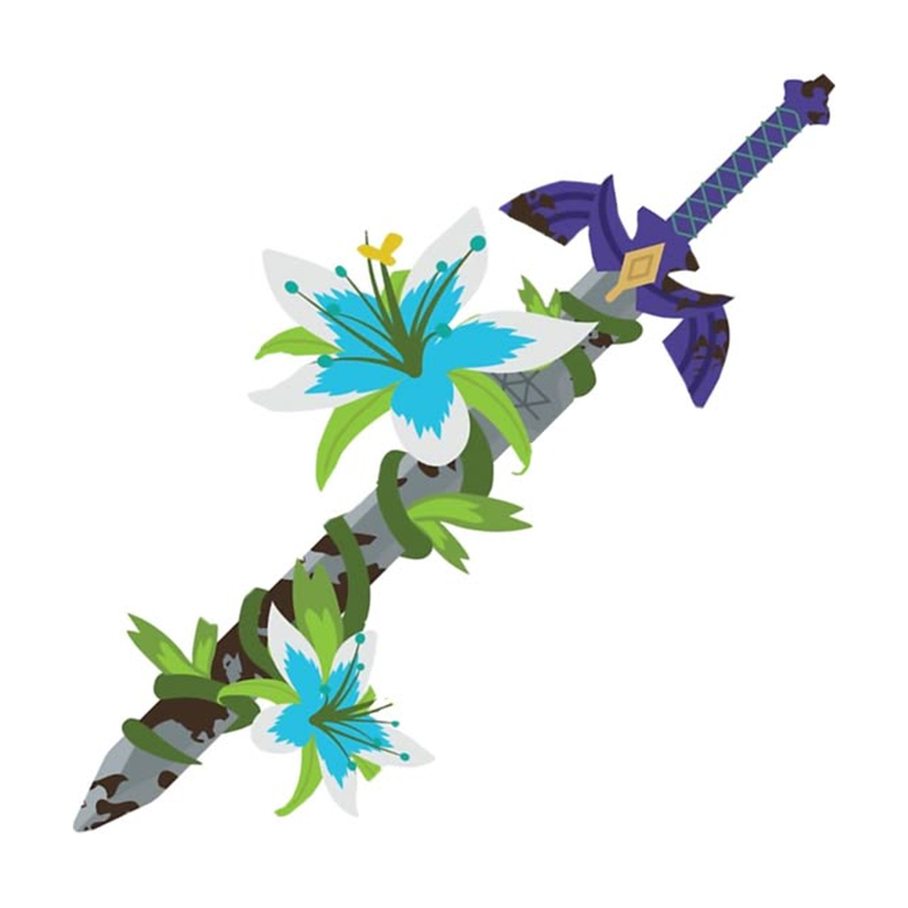

<p align="center">
  
</p>

<h1 align="center">WSword</h1>

<p align="center">
  <b><i>The Legend of Zelda: Breath of the Wild</i>, recompiled to run natively on your PC and your tablet.</b><br>
  <b>English</b> | <a href="README.pt-BR.md">Português</a>
</p>

<p align="center">
  <a href="https://github.com/RJ22256/SheikahSlate/releases"><b>Download</b></a> ·
  <a href="https://github.com/RJ22256/SheikahSlate/blob/pc-windows/docs/PC.md">PC guide</a> ·
  <a href="docs/TAB-S10-ULTRA.md">Tablet guide</a> ·
  <a href="https://github.com/RJ22256/SheikahSlate/issues">Report a problem</a>
</p>


## What is WSword?

WSword runs *Breath of the Wild* as a native program. It isn't an emulator. The game's own Nintendo Switch code is
translated ahead of time into native code for your machine, once, when you set it up. Its graphics are drawn with
Vulkan on your own GPU. The game runs as it was written, at frame rates, resolutions and settings the Switch could
never reach.

It comes in two editions:

| | **WSword for PC** | **WSword for Android tablets** |
| --- | --- | --- |
| Runs on | Windows 10 / 11, 64-bit | Samsung Galaxy Tab S10 Ultra |
| Download | `WSword-<version>-windows.zip` | `WSword-<version>-TabS10Ultra.apk` |
| Game version | 1.9.0 (recommended) or 1.8.2 | 1.0.0, 1.6.0, 1.8.2 or 1.9.0 |
| Guide | [docs/PC.md](https://github.com/RJ22256/SheikahSlate/blob/pc-windows/docs/PC.md) | [docs/TAB-S10-ULTRA.md](docs/TAB-S10-ULTRA.md) |
| Source | [`pc/` on the `pc-windows` branch](https://github.com/RJ22256/SheikahSlate/tree/pc-windows/pc) | this branch (`main`) |

Both are on the [Releases](https://github.com/RJ22256/SheikahSlate/releases) page.

> [!IMPORTANT]
> **No game files are included.** You need your own dump of *Breath of the Wild* from your own Switch: the ExeFS and
> the RomFS (with the update merged in), extracted. How to obtain it isn't provided here.

## WSword for PC

- **Fast.** 60 to 120 fps and beyond, the game's speed right at every frame rate. The geometry stays in video memory,
  and the CPU and GPU work side by side.
- **Sharp.** Any resolution, with AMD FSR or **NVIDIA DLSS** upscaling (your own `nvngx_dlss.dll`), anti-aliasing,
  sharpening and shadow maps up to 8192 pixels.
- **Frame generation.** AMD FSR 3, **Lossless Scaling** 2x / 3x / 4x (your own `Lossless.dll`), or **NVIDIA DLSS
  frame generation** on RTX 40 and 50 (your own `nvngx_dlssg.dll`).
- **Ray-traced shadows** (experimental). The sun's shadows traced on GPUs with hardware ray tracing: sharp where
  things touch, soft with distance.
- **ReShade, built in.** WSword loads your own ReShade itself, with no installer, and gives its effects the game's
  real depth.
- **Mods.** Switch RomFS mods in the Ryujinx / Yuzu layout: import a folder, turn each one on or off. DLC mods too.
- **Settings over the game.** F1 opens WSword's settings in the game. A start screen (*WSword Configuration*)
  holds your saves, game files, modes (Battery, Performance, Turbo, Unlocked) and everything else.
- **Play your way.** Keyboard and mouse with every key changeable, any controller, gyro aiming.

**Getting started:** unzip it anywhere you can write to, run `WSword.exe`, choose your extracted game and press
**Set up game files**. It builds the game's code once (a few minutes), then goes straight into the game.

You need a GPU with a Vulkan 1.3 driver, 16 GB of RAM and about 20 GB free. The full guide, with every option:
[docs/PC.md](https://github.com/RJ22256/SheikahSlate/blob/pc-windows/docs/PC.md).

## WSword for Android tablets

Made for the **Galaxy Tab S10 Ultra** (SM-X920 / X926B / X920N / X926N) and its 14.6" 16:10 screen:

- **Modes** made from the tablet's own measurements: Battery, Performance, Turbo (40 fps) and Turbo 60.
- **The picture:** 16:9 fitted to the screen without stretching, drawn around the camera notch, at 120 Hz with
  evenly paced frames.
- **On-screen controls** sized in millimetres, where your thumbs are.
- **Frame generation** with your own Lossless Scaling `Lossless.dll`.
- **Mali GPU:** fixes for missing text and broken decals, and faster render passes.
- **Saves and mods:** saves import and export (a .zip, or an emulator's save folder), the DLC, mods, and game files
  used in place.

**Getting started:** install the APK, open WSword, go to **Set up game files** and choose the folder with your
`exefs` and `romfs`. It builds the game's code on the tablet (a long wait, the first time only). It installs as its
own app (`com.sheikahslate.tab`). The tablet edition is a beta: [docs/TAB-S10-ULTRA.md](docs/TAB-S10-ULTRA.md) has the
details and a test checklist.

## Reporting a problem

Open an [issue](https://github.com/RJ22256/SheikahSlate/issues) with what happened and the log:
- **PC:** `WSword.log`, next to `WSword.exe`.
- **Tablet:** turn on **Save a log file** in the start screen's Settings, then send `sheikahslate-log.txt` from the
  folder you chose.

For a graphics problem on PC, **Ctrl+F9** in the game writes a report of the frame to the `build\rt-report` folder.
Send that folder too.

## Building from source

- **PC:** on the [`pc-windows`](https://github.com/RJ22256/SheikahSlate/tree/pc-windows) branch, see
  [docs/BUILD-windows.md](https://github.com/RJ22256/SheikahSlate/blob/pc-windows/docs/BUILD-windows.md). Releases are
  built by GitHub Actions.
- **Tablet:** with the Android SDK, NDK 30.0.16248370 and CMake 3.30.4:

  ```bash
  git clone --recursive https://github.com/bylaws/libadrenotools third_party/libadrenotools
  android/deps/build_deps.sh          # SDL3, shaderc, Vulkan headers, volk, VMA
  android/deps/build_ffmpeg.sh        # optional: the game's movies and the start screen's background
  android/deps/build_gen_deps.sh      # the on-device game code builder
  cd android/sheikahslate && ./gradlew assembleRelease
  ```

## Credits

WSword is built on open-source work, and these people made it possible:

- [peiikai](https://github.com/peiikai): [LAS Recomp](https://github.com/peiikai/LASRecomp), the static
  recompiler and runtime at its core.
- [Revivedx](https://github.com/Revivedx) and contributors: [Savage Wind Recomp](https://github.com/Revivedx/SavageWindRecomp),
  the PC runtime.
- [mamcjr](https://github.com/mamcjr): [BOTWRecompAndroid](https://github.com/mamcjr/BOTWRecompAndroid) and
  [LASRecompAndroid](https://github.com/mamcjr/LASRecompAndroid), the Android runtime.
- [Nycolazs](https://github.com/Nycolazs) (LASRecomp-Android-Plus), the [zeldaret/botw](https://github.com/zeldaret/botw)
  decompilation and [open-ead/sead](https://github.com/open-ead/sead).
- **Graphics:** AMD FidelityFX FSR 1 and FSR 3 (MIT), Qualcomm Snapdragon GSR (BSD-3-Clause), SMAA (MIT),
  [lsfg-vk](https://github.com/PancakeTAS/lsfg-vk) by PancakeTAS and contributors (GPL-3.0), and NVIDIA's DLSS and
  Streamline SDKs.
- **ReShade:** WSword uses ReShade's add-on API headers (BSD-3-Clause) to talk to your copy of
  [ReShade](https://reshade.me) by crosire.
- **Libraries:** SDL (zlib), Dear ImGui (MIT), volk (MIT), Vulkan Memory Allocator (MIT), shaderc (Apache 2.0),
  libadrenotools (BSD-2-Clause), FFmpeg (LGPL), LZ4 (BSD-2-Clause), Capstone (BSD-3-Clause), Unicorn (GPLv2),
  Python (PSF) and Zig (MIT). Fonts: Inter, Baloo 2 (OFL), DejaVu Sans.

Made with AI (Claude, by Anthropic).

## Licence

WSword's own code is under the MIT licence ([LICENSE](LICENSE)). Both editions include lsfg-vk, so a build is a
combined work under **GPL-3.0**: anyone you give it to must be able to get its source (this repository).
Each component keeps its own licence, listed in [third_party](third_party) and in each release.

*The Legend of Zelda*, *Breath of the Wild* and *Sheikah* are trademarks of Nintendo. *Galaxy* and *Galaxy Tab* are
trademarks of Samsung. NVIDIA, RTX and DLSS are trademarks of NVIDIA. WSword is a fan project, not affiliated with or
endorsed by Nintendo, Samsung, NVIDIA, AMD, Lossless Scaling's developers or ReShade.
