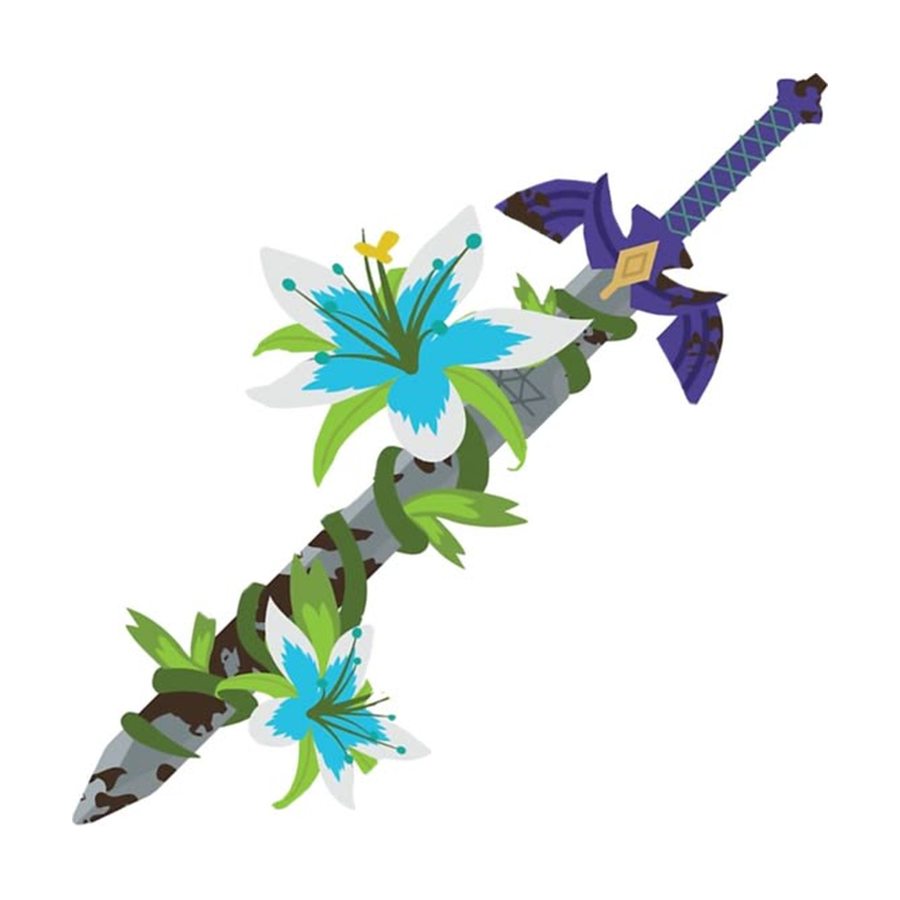
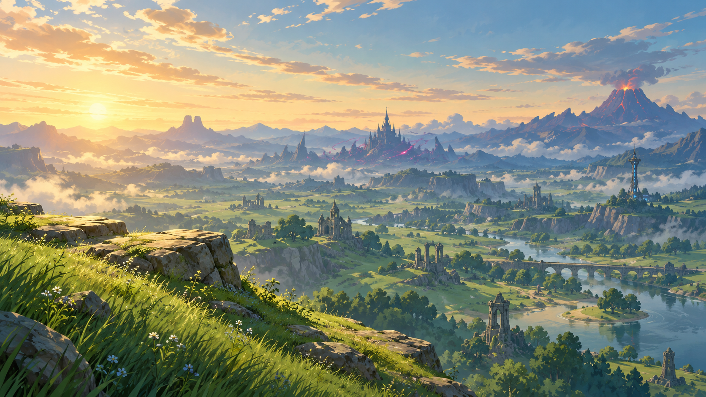

<p align="center">
  
</p>

<h1 align="center">WSword</h1>

<p align="center">
  <b><i>The Legend of Zelda: Breath of the Wild</i>, recompilado para rodar nativamente no seu PC e no seu tablet.</b><br>
  <a href="README.md">English</a> | <b>Português</b>
</p>

<p align="center">
  <a href="https://github.com/RJ22256/SheikahSlate/releases"><b>Baixar</b></a> ·
  <a href="https://github.com/RJ22256/SheikahSlate/blob/pc-windows/docs/PC.md">Guia do PC</a> ·
  <a href="docs/TAB-S10-ULTRA.md">Guia do tablet</a> ·
  <a href="https://github.com/RJ22256/SheikahSlate/issues">Relatar um problema</a>
</p>



## O que é o WSword?

O WSword roda *Breath of the Wild* como um programa nativo. Não é um emulador. O próprio código do jogo para Nintendo
Switch é traduzido de antemão para código nativo da sua máquina, uma vez só, quando você o configura. Os gráficos são
desenhados com Vulkan na sua própria GPU. O jogo roda como foi escrito, com taxas de quadros, resoluções e opções que o
Switch nunca alcançaria.

Existem duas edições:

| | **WSword para PC** | **WSword para tablets Android** |
| --- | --- | --- |
| Roda em | Windows 10 / 11, 64 bits | Samsung Galaxy Tab S10 Ultra |
| Download | `WSword-<versão>-windows.zip` | `WSword-<versão>-TabS10Ultra.apk` |
| Versão do jogo | 1.9.0 (recomendada) ou 1.8.2 | 1.0.0, 1.6.0, 1.8.2 ou 1.9.0 |
| Guia | [docs/PC.md](https://github.com/RJ22256/SheikahSlate/blob/pc-windows/docs/PC.md) | [docs/TAB-S10-ULTRA.md](docs/TAB-S10-ULTRA.md) |
| Código-fonte | [`pc/` no branch `pc-windows`](https://github.com/RJ22256/SheikahSlate/tree/pc-windows/pc) | este branch (`main`) |

As duas estão na página de [Releases](https://github.com/RJ22256/SheikahSlate/releases).

> [!IMPORTANT]
> **Nenhum arquivo do jogo está incluído.** Você precisa do seu próprio dump de *Breath of the Wild*, tirado do seu
> próprio Switch: o ExeFS e o RomFS (com a atualização mesclada), extraídos. Como obtê-lo não é explicado aqui.

## WSword para PC

- **Rápido.** De 60 a 120 fps e além, com o jogo na velocidade certa em qualquer taxa de quadros. A geometria fica na
  memória de vídeo, e a CPU e a GPU trabalham lado a lado.
- **Nítido.** Qualquer resolução, com upscaling AMD FSR ou **NVIDIA DLSS** (o seu próprio `nvngx_dlss.dll`),
  anti-aliasing, nitidez e mapas de sombra de até 8192 pixels.
- **Geração de quadros.** AMD FSR 3, **Lossless Scaling** 2x / 3x / 4x (o seu próprio `Lossless.dll`) ou **geração de
  quadros NVIDIA DLSS** nas RTX 40 e 50 (o seu próprio `nvngx_dlssg.dll`).
- **Sombras com ray tracing** (experimental). As sombras do sol traçadas em GPUs com ray tracing por hardware: nítidas
  onde as coisas se tocam, suaves com a distância.
- **ReShade embutido.** O WSword carrega o seu próprio ReShade, sem instalador, e dá aos efeitos dele a profundidade
  real do jogo.
- **Mods.** Mods de RomFS do Switch no formato do Ryujinx / Yuzu: importe uma pasta, ligue ou desligue cada um. Mods
  da DLC também.
- **Configurações por cima do jogo.** F1 abre as configurações do WSword dentro do jogo. Uma tela inicial (*WSword
  Configuration*) reúne seus saves, os arquivos do jogo, os modos (Bateria, Desempenho, Turbo, Sem limite) e todo o
  resto.
- **Jogue do seu jeito.** Teclado e mouse com todas as teclas configuráveis, qualquer controle, mira por giroscópio.

**Para começar:** descompacte em qualquer lugar onde você possa gravar, abra o `WSword.exe`, escolha o jogo extraído e
clique em **Set up game files**. Ele compila o código do jogo uma vez (alguns minutos) e depois vai direto para o jogo.

Você precisa de uma GPU com driver Vulkan 1.3, 16 GB de RAM e cerca de 20 GB livres. O guia completo, com todas as
opções: [docs/PC.md](https://github.com/RJ22256/SheikahSlate/blob/pc-windows/docs/PC.md).

## WSword para tablets Android

Feito para o **Galaxy Tab S10 Ultra** (SM-X920 / X926B / X920N / X926N) e a tela de 14,6" em 16:10:

- **Modos** feitos a partir das medições do próprio tablet: Bateria, Desempenho, Turbo (40 fps) e Turbo 60.
- **A imagem:** 16:9 encaixado na tela sem esticar, desenhada em volta do entalhe da câmera, a 120 Hz com quadros em
  ritmo uniforme.
- **Controles na tela** dimensionados em milímetros, onde os seus polegares ficam.
- **Geração de quadros** com o seu próprio `Lossless.dll` do Lossless Scaling.
- **GPU Mali:** correções para texto faltando e decalques quebrados, e passes de renderização mais rápidos.
- **Saves e mods:** importação e exportação de saves (um .zip, ou a pasta de saves de um emulador), a DLC, mods e
  arquivos do jogo usados no lugar.

**Para começar:** instale o APK, abra o WSword, vá em **Set up game files** e escolha a pasta com o seu `exefs` e
`romfs`. Ele compila o código do jogo no tablet (uma espera longa, só da primeira vez). Ele é instalado como um app
próprio (`com.sheikahslate.tab`). A edição para tablet é beta: [docs/TAB-S10-ULTRA.md](docs/TAB-S10-ULTRA.md) tem os
detalhes e uma lista de testes.

## Relatar um problema

Abra uma [issue](https://github.com/RJ22256/SheikahSlate/issues) com o que aconteceu e o log:
- **PC:** `WSword.log`, ao lado do `WSword.exe`.
- **Tablet:** ligue **Save a log file** nas configurações da tela inicial e envie o `sheikahslate-log.txt` da pasta que
  você escolheu.

Para um problema gráfico no PC, **Ctrl+F9** no jogo grava um relatório do quadro na pasta `build\rt-report`. Envie
essa pasta também.

## Compilar a partir do código-fonte

- **PC:** no branch [`pc-windows`](https://github.com/RJ22256/SheikahSlate/tree/pc-windows), veja
  [docs/BUILD-windows.md](https://github.com/RJ22256/SheikahSlate/blob/pc-windows/docs/BUILD-windows.md). As releases
  são compiladas pelo GitHub Actions.
- **Tablet:** com o Android SDK, o NDK 30.0.16248370 e o CMake 3.30.4:

  ```bash
  git clone --recursive https://github.com/bylaws/libadrenotools third_party/libadrenotools
  android/deps/build_deps.sh          # SDL3, shaderc, cabeçalhos Vulkan, volk, VMA
  android/deps/build_ffmpeg.sh        # opcional: os vídeos do jogo e o fundo da tela inicial
  android/deps/build_gen_deps.sh      # o compilador do código do jogo no aparelho
  cd android/sheikahslate && ./gradlew assembleRelease
  ```

## Créditos

O WSword é construído sobre trabalho de código aberto, e estas pessoas o tornaram possível:

- [peiikai](https://github.com/peiikai): [LAS Recomp](https://github.com/peiikai/LASRecomp), o recompilador estático
  e o runtime no seu núcleo.
- [Revivedx](https://github.com/Revivedx) e colaboradores: [Savage Wind Recomp](https://github.com/Revivedx/SavageWindRecomp),
  o runtime do PC.
- [mamcjr](https://github.com/mamcjr): [BOTWRecompAndroid](https://github.com/mamcjr/BOTWRecompAndroid) e
  [LASRecompAndroid](https://github.com/mamcjr/LASRecompAndroid), o runtime do Android.
- [Nycolazs](https://github.com/Nycolazs) (LASRecomp-Android-Plus), a decompilação [zeldaret/botw](https://github.com/zeldaret/botw)
  e [open-ead/sead](https://github.com/open-ead/sead).
- **Gráficos:** AMD FidelityFX FSR 1 e FSR 3 (MIT), Qualcomm Snapdragon GSR (BSD-3-Clause), SMAA (MIT),
  [lsfg-vk](https://github.com/PancakeTAS/lsfg-vk) de PancakeTAS e colaboradores (GPL-3.0), e os SDKs DLSS e Streamline
  da NVIDIA.
- **ReShade:** o WSword usa os cabeçalhos da API de add-ons do ReShade (BSD-3-Clause) para conversar com a sua cópia do
  [ReShade](https://reshade.me), de crosire.
- **Bibliotecas:** SDL (zlib), Dear ImGui (MIT), volk (MIT), Vulkan Memory Allocator (MIT), shaderc (Apache 2.0),
  libadrenotools (BSD-2-Clause), FFmpeg (LGPL), LZ4 (BSD-2-Clause), Capstone (BSD-3-Clause), Unicorn (GPLv2),
  Python (PSF) e Zig (MIT). Fontes: Inter, Baloo 2 (OFL), DejaVu Sans.

Feito com IA (Claude, da Anthropic).

## Licença

O código próprio do WSword está sob a licença MIT ([LICENSE](LICENSE)). As duas edições incluem o lsfg-vk, então um
build é uma obra combinada sob a **GPL-3.0**: quem o receber de você tem que poder obter o código-fonte (este
repositório). Cada componente mantém a sua própria licença, listada em [third_party](third_party) e em cada release.

*The Legend of Zelda*, *Breath of the Wild* e *Sheikah* são marcas registradas da Nintendo. *Galaxy* e *Galaxy Tab*
são marcas registradas da Samsung. NVIDIA, RTX e DLSS são marcas registradas da NVIDIA. O WSword é um projeto de fã, sem
afiliação ou endosso da Nintendo, da Samsung, da NVIDIA, da AMD, dos desenvolvedores do Lossless Scaling ou do ReShade.
